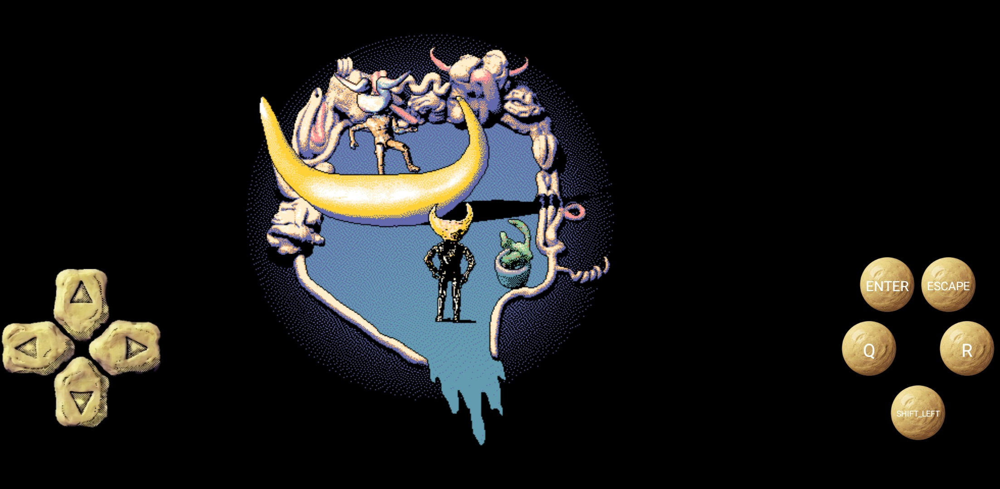
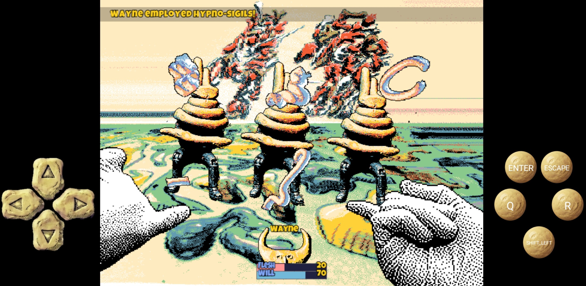
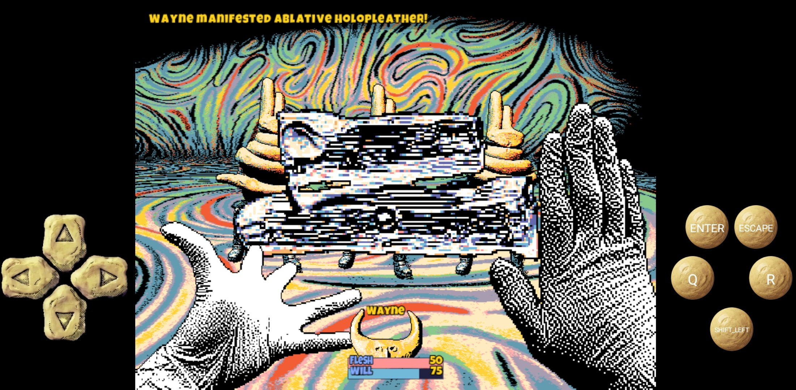
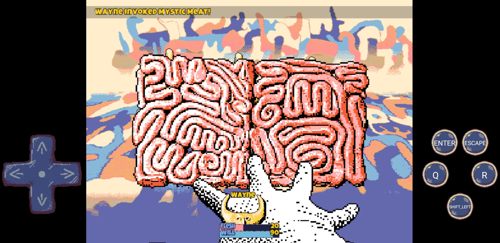
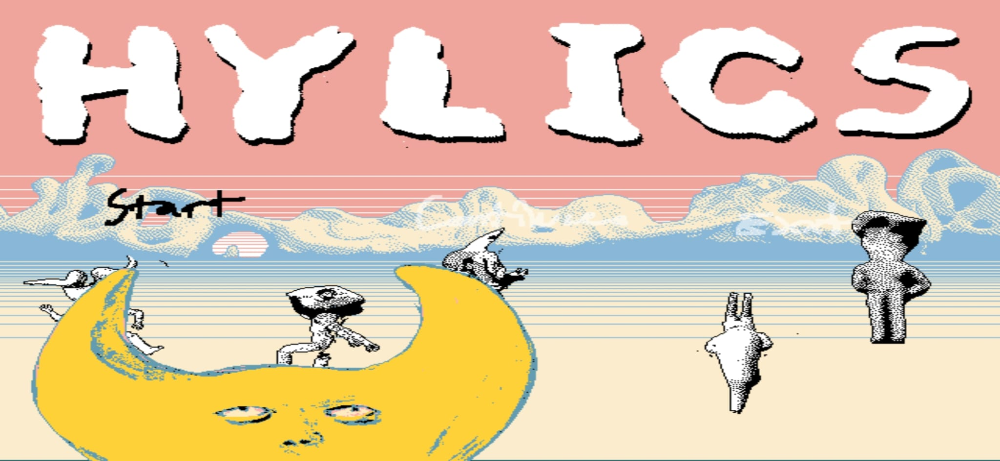

# Hylics_Android_Port

(This is an unofficial port. If you enjoy the game, please consider supporting the original game❤️)

Official game : https://store.steampowered.com/app/397740/Hylics/

The purpose of this port is to make Hylics playable on Android devices
This port is based on JoiPlay's RPG Maker player (mkxp engine)

The game is currently available in English only.
I'm still working on adding translations, so no additional languages are included in the port yet.

I haven't fully tested the game myself. I've only done a quick playthrough/check to see how it runs.
So please leave feedback for any issues or suggestions

Information about the different versions (The mobile controller designs were made with AI. "hylics.apk and hylics_b.apk")

Hylics.apk: The main design I originally had in mind for the port.

Hylics_b.apk: A simpler, more minimal design.

Hylics_clear.apk: A version with transparent on-screen controls and a fullscreen patch.
Recommended for those who want to play in fullscreen or use tablets and other devices with larger displays.

Hylics_Handheld.apk: Recommended for playing the port on Android-based handheld gaming devices.
On-screen controls are disabled. Fullscreen patch is applied.
Note: The game does not have proper native gamepad support, so you may encounter some unusual behavior with the controls.
I've made some adjustments to improve gamepad compatibility, but I haven't been able to test them yet.

ABOUT Hylics_clear.apk:

On some phones with camera notches, a black bar may appear along the edge of the screen. This is not caused by the app itself, but by your phone's notch settings.
Look for an option called "Notch", "Display Cutout", or "Full-screen Apps" in your phone's settings, and configure it to allow the game to use the area around the notch.
The exact name and location of this setting may vary depending on your phone's manufacturer and Android version.
This issue should not occur on tablets or phones without a camera notch.

Hylics.apk

Hylics_b.apk

Hylics_clear.apk

Hylics_Handheld.apk

